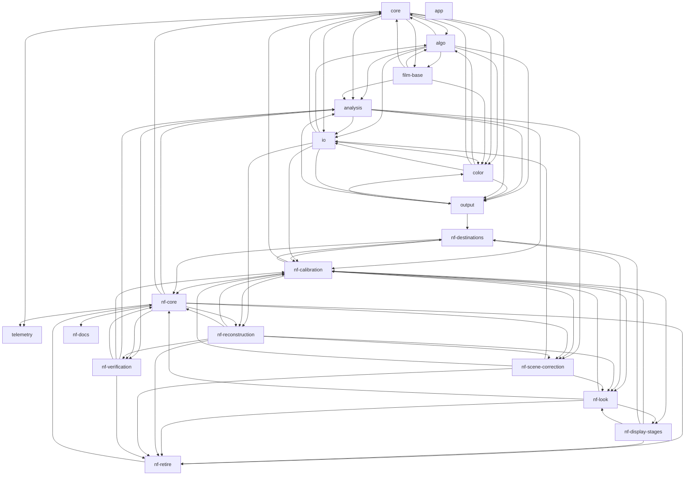

<!-- Generated by the tasks CLI. Edit tasks/ and run `tasks render`; never edit this file. -->

# Hanten — Tasks

The plan for Hanten, the `hanten` negative→positive converter.
[design-spec.md](design-spec.md) is the design; this index is generated from the task
files' frontmatter by the `tasks` CLI (the `tasks` plugin's `task-tracking` skill) —
never edit it by hand.

> **Progress log:** one file per epic under [progress/](progress/) records *how*
> each task is carried out — what was done, decisions made, what works, what
> doesn't. **Before starting a task, read your epic's progress file in full, plus
> the `Epic summary` section of every epic you depend on** — then log your own
> task's progress as you work (`tasks log <id> "…"`), so the next task can build on
> what you learned.

## Dependencies

Epic rollup, derived from the open tasks' dependencies (a cycle here is not a defect):

## Tasks

**Legend:** `[ ]` todo · `[~]` doing · `[x]` done · `[-]` closed. Each task file's frontmatter is the source of truth; query with `tasks ready`, `tasks show <id>`.

### core — [progress](progress/core.md)
> Project skeleton, shared types (`types.rs`), the clap command surface
> (`cli.rs` / `main.rs`), end-to-end orchestration — including
> `pipeline/stages.rs`, the pure algorithm→output-color render core the CLI
> drives — the roll/batch workflow, and the cross-cutting cleanup and release
> work that lands in those files.

- [ ] [Split a two-half-frame file](tasks/core/half-frame-split.md) — one file holding two half-frames becomes two pictures, each its own frame
- [ ] [Stable codes for warnings and errors](tasks/core/message-codes.md) — every warning and error carries a code and facts; the CLI formats its prose from them, the app maps codes to its own handling
- [ ] [Release Readiness](tasks/core/release-readiness.md) — from the release-readiness review: (1) correct public docs that misstate the product (README "pre-implementation" + "planned", TASKS.md "two algorithms" omitting sigmoid, obsolete `--out-depth` in…
- [x] [Calibrate a roll without named reference frames](tasks/core/auto-calibration.md) — renamed from `core/base-acquisition-planner`: detect the unexposed frame and leader in the roll, cross-frame agreement, provenance + confidence, a loud refusal
- [x] [The `calibration` recipe section](tasks/core/calibration-recipe-section.md) — `film_base` and `dmax` move into their own top-level section
- [x] [CLI Framework](tasks/core/cli-framework.md)
- [x] [Conversion versioning & baseline comparison](tasks/core/conversion-versioning.md) — report identity and pipeline_version, the golden drift gate, the {meta,params} sidecar envelope, and nctool compare
- [x] [Crop and rotate](tasks/core/crop-rotate.md) — crop and rotate as flags and recipe keys; a crop also narrows the measurement region
- [x] [Dependency & Module Hygiene](tasks/core/dependency-hygiene.md) — from the hygiene review: dropped the unused `kamadak-exif` and `palette`, and moved `image` (test-only, JPEG decode) to a JPEG-only dev-dependency
- [x] [Key roll frames by relative path](tasks/core/frame-keys-by-path.md) — roll.frames is keyed by file name; a recipe applied to a same-named file elsewhere shares its entry
- [x] [Rename internal identifiers to docs/terminology.md's terms](tasks/core/internal-term-renames.md) — Rust identifiers, constants and the remaining doc comments that contradict docs/terminology.md
- [x] [`measure-base`, and `measure-roll` as the one-stop measurement](tasks/core/measure-base.md) — `measure-roll --unexposed` measures the base too and writes one recipe (`calibration` + `roll`)
- [x] [Pipeline Orchestration](tasks/core/pipeline-orchestration.md)
- [x] [Name the product Hanten, and fix the boundary](tasks/core/product-naming.md) — Hanten as the product, `nc` as the internal name
- [x] [Author a reusable pipeline profile without an image](tasks/core/profile-authoring.md) — `hanten params` becomes `hanten profile`: takes the override flags, validates config-only, writes annotated JSONC via `--out`, needs no image
- [x] [Project Foundation and Core Types](tasks/core/project-foundation.md)
- [x] [Layered recipe composition](tasks/core/recipe-composition.md) — repeatable `--params` (file or `-` for stdin), `roll` gains convert's override flags, one precedence chain `defaults < params A < params B < … < flags`
- [x] [Recipe replay fidelity](tasks/core/recipe-replay-fidelity.md) — every recipe document hanten writes (`--dump-params`, `hanten params`, `measure-base`/`measure-roll --out`) is a `{meta, params}` envelope stamped with the build's identity, so a replay under…
- [x] [Rename the decode and look misnomers (--density-gamma, reconstruction.anchor, look stage "contrast")](tasks/core/rename-decode-look-misnomers.md) — public names that say the wrong quantity in the decode and the look
- [x] [Rename the fit-range and HDR misnomers (--display-tone-headroom, --display-black, linear_headroom)](tasks/core/rename-fit-range-misnomers.md) — the highlight range gets its own public name; display black and the duplicated display peak
- [x] [Rename the roll and report misnomers (frames.*.exposure, neutral_balance, slope_bound, area tilt, saturation_margin)](tasks/core/rename-roll-report-misnomers.md) — roll keys and report fields whose names collide or mislead
- [x] [Roll conversion (batch with a shared frozen recipe)](tasks/core/roll-conversion.md)
- [x] [`roll`'s measure mode](tasks/core/roll-measure-mode.md) — `roll --unexposed <file|auto> [--leader L]` measures the base and the roll, then converts
- [x] [Stdout broken-pipe safety](tasks/core/stdout-broken-pipe-safety.md) — make every stdout JSON write (the report via `emit_report`, `hanten params`) tolerate a closed pipe (e.g
- [x] [Value-domain terminology & Dmin/Dmax clarity](tasks/core/value-domain-terminology.md) — one terminology doc (value spaces + per-stage quantities, public vs internal) and an agent skill; "film base" leads over `Dmin` in user-facing text
- [-] [Warn when a recipe's auto modes silently defeat a roll](tasks/core/unfrozen-auto-mode-warning.md)

### io — [progress](progress/io.md)
> Reading scans and writing artifacts: `io/decode.rs`, `io/encode.rs`,
> `pipeline/input_semantics.rs` (the resolver that interprets the SilverFast XMP
> packet), and the buffer/atomicity strategy for whole-image and streamed I/O.

- [ ] [Read camera scans](tasks/io/camera-scan-input.md) — accept camera-scanned negatives (the asserted-linear TIFF path, or raw/DNG); a release gate for the desktop app
- [ ] [Decode a single-channel gray SilverFast scan](tasks/io/gray-primary-decode.md) — accept a 16-bit grayscale primary (IR page unchanged); nc refuses these HP5 scans today · **low priority**
- [ ] [Scanner Density Calibration](tasks/io/scanner-density-calibration.md) — turn the density-scale question into a shipped, reusable scanner profile · **waits on** `analysis/calibration-frame-capture`
- [ ] [Slide film input](tasks/io/slide-film-input.md) — convert positive (E-6) film: no film base or decode, enters at the working space; no slide scans to verify against yet · **low priority**
- [ ] [Streaming / Tiled I/O](tasks/io/streaming-tiled-io.md) — strip/tile decode for very large inputs; STEP 0 evaluated no-go (2026-10-13), revisit only if the input envelope grows · **low priority**
- [ ] [Name a truncated input file](tasks/io/truncated-file-fault.md) — a file shorter than its own header declares (a cloud file still downloading) gets its own fault, not a decode error
- [x] [Input Data Semantics and Validation](tasks/io/input-data-semantics.md) — resolve transfer encoding independently from scanner-device versus colorimetric meaning
- [x] [Memory Preflight & In-Place Transform](tasks/io/memory-preflight.md) — from the memory-safety review (Phase A, cheap): predict peak allocation and fail loudly over a budget before allocating (reconciling the dishonest 4 GiB input limit), and drop the whole-image clone…
- [x] [Multi-frame runs outgrow the per-frame memory model](tasks/io/multi-frame-memory-growth.md) — macOS malloc kept freed full-frame blocks resident, so a roll's peak climbed with every slightly larger frame
- [x] [Negatives scanned in positive mode](tasks/io/positive-input-mode.md) — convert a negative scanned in SilverFast's positive mode (same raw transmission, IT8 profile recorded, not applied), warning when a frame does not look like a negative under its base
- [x] [SilverFast HDR/HDRi Decode](tasks/io/silverfast-decode.md)
- [x] [TIFF Encode and Output](tasks/io/tiff-encode.md)
- [x] [Transactional Output Writes](tasks/io/transactional-output-writes.md) — from the output-atomicity review: write every artifact (primary TIFF, IR, sidecar, report-file) to a same-directory temp, fsync, then rename, so a failed/interrupted run never leaves a truncated…

### film-base — [progress](progress/film-base.md)
> `pipeline/film_base.rs` and the `hanten measure-base` measurement surface: locating
> unexposed film, deriving the `Dmin` transmission anchor, and measuring the
> roll-fixed `Dmax` density anchor. `Dmin` and `Dmax` are **different quantities**
> (design-spec §4) that happen to share this code.

- [ ] [Can the content base use the rebate?](tasks/film-base/content-base-rebate.md) — spike: compare --base-content at the default inset and at --measure-inset 0 against measured bases
- [ ] [Calibrate from a single part-exposed frame](tasks/film-base/half-frame-calibration.md) — **deferred, blocks nothing**: one frame that is part unexposed and part leader serving as both references (HP5 frame 1330 is one)
- [x] [Robust auto film-base detection](tasks/film-base/auto-base-redesign.md)
- [x] [Content-based film-base fallback (Tier 3)](tasks/film-base/content-fallback.md) — shipped as `measure-roll --base-content` and `roll --base-content`: the pooled p99 of the picture frames' effective areas, written as an explicit base with `content_base` evidence
- [x] [Roll-fixed Dmax from a fully-exposed reference frame](tasks/film-base/dmax-reference.md) — shipped roll-fixed acquisition/default policy
- [x] [Reuse-ready `nc estimate` output](tasks/film-base/estimate-reuse-output.md)
- [x] [Film-Base / Dmin Estimation](tasks/film-base/estimation.md)
- [x] [The effective measurement area](tasks/film-base/holder-depth-mask.md) — one region every measurement path starts from: IR holder cut, then a user-sizable static inset
- [x] [Rebuild Dmin and Dmax measurement on area x method](tasks/film-base/holder-masked-measurement.md) — `estimate FRAME` measures an unexposed frame's effective area at the median (p97 over one population sits 0.01-0.085 density pale on 9 real frames)
- [x] [IR-assisted film-holder detection](tasks/film-base/ir-holder-detection.md)
- [x] [Decide IR usability by measurement, not by declared film type](tasks/film-base/ir-usability-detection.md) — key IR holder detection on the **plane itself** rather than `--film-type`, which becomes a hint
- [x] [Validate reference frames by tiling](tasks/film-base/tiling-uniformity-validator.md) — `measure-base` tiles the effective area 4x4 in the median's own scan (`pipeline::area_uniformity`): within-tile grain, outlier tiles set aside against the plane through the rest, and that plane's…
- [-] [Neutral-base robustness for auto film-base detection](tasks/film-base/auto-base-neutral-stock.md)
- [-] [Why `--auto-base` refuses every real scan](tasks/film-base/auto-base-real-scan-refusal.md)
- [-] [Clipped Dmax Reference Handoff](tasks/film-base/clipped-dmax-reference.md)
- [-] [Stock-aware Dmax plausibility (dense-base stocks)](tasks/film-base/dense-base-dmax-plausibility.md)
- [-] [Dmax Anchor Reliability](tasks/film-base/dmax-anchor-reliability.md)
- [-] [Per-channel Dmax and the gray-mean reduction](tasks/film-base/dmax-per-channel-reduction.md) — closed into `nf-calibration/scale-gamma-loop`
- [-] [The holder march cap: a premise, not a defect](tasks/film-base/holder-cap-contamination.md)
- [-] [Light film holder support](tasks/film-base/white-holder-support.md)

### algo — [progress](progress/algo.md)
> `src/algo/`: the `reconstruct` surface, negative
> reconstruction, the density curves (exponential / sigmoid), and the tone,
> white-balance, and color-model parameters of that stage. Deterministic
> statistics only — no ML.

- [x] [Auto Neutral White Balance](tasks/algo/auto-neutral-wb.md)
- [x] [Pin the `characteristic` Curve Against Regression](tasks/algo/characteristic-curve-coverage.md) — the curve's tables were well covered and its **wiring** barely: a refactor between `to_density` and `FilmRgbImage` moved every characteristic pixel with all four gates green
- [x] [Named conversion presets (`--preset`)](tasks/algo/conversion-presets.md) — `--preset` selecting one of five reconstruction + display bundles by name, folding the coupled magic numbers (a per-reconstruction `print_exposure` from 1.59 to 2.17, the per-stock aim-matched red…
- [x] [Density-Domain Algorithm](tasks/algo/density.md)
- [x] [Density Safety Bounds](tasks/algo/density-safety-bounds.md) — : a value no longer reaches fit range's internal errors
- [x] [Display-Range White Anchor (Dmax)](tasks/algo/dmax-white-anchor.md) — shipped legacy semantics
- [x] [Anchor Placement for the Exponential Curve](tasks/algo/exponential-anchor-placement.md) — all four placements now exist on **both** curves behind one curve-neutral `--anchor-*` family, so contrast and endpoint placement stop fighting
- [x] [Film-Stock Profiles](tasks/algo/film-stock-profiles.md) — a selectable registry of known stocks carrying the per-stock reference densities that reconstruction needs (the mid-grey and diffuse-white aims, their difference, the mid-above-base offset and the…
- [x] [Algorithm Interface](tasks/algo/interface.md)
- [x] [Near-black collapse warning](tasks/algo/near-black-collapse-warning.md) — : a rendered channel whose p99.9 (`pipeline::near_black`, on the display-referred buffer before the encode) is more than 10 stops below diffuse white warns, beside part 2's all-zero rule
- [x] [Negative Reconstruction and Density Curves](tasks/algo/negative-reconstruction-density-curves.md) — adopt tagged simple/density reconstruction, make exponential/sigmoid tagged density curves, and produce typed `FilmRgbImage`
- [x] [Reconstruction / Render Curve Split](tasks/algo/reconstruction-render-curve-split.md) — move the sigmoid character to the render stage, restoring the separate-sub-stages rule
- [x] [Reference-Anchored Sigmoid Calibration and Redesign](tasks/algo/reference-anchored-sigmoid.md) — reproduce and quantify the shipped sigmoid's raised, narrow real-roll shadow spread, then choose the least invasive defaults/semantics/equation remedy against frozen film-master/SDR/HDR metrics
- [x] [Regional (Shadow/Highlight) Color Balance](tasks/algo/regional-color-balance.md)
- [x] [Sigmoid / H&D-Curve Tone Algorithm](tasks/algo/sigmoid.md)
- [x] [Simple Inversion Algorithm](tasks/algo/simple.md)
- [-] [Exclude the holder from content-driven measurement](tasks/algo/auto-anchor-interior-measurement.md)
- [-] [Black & White Negative Support (Mono Color Model)](tasks/algo/bw-support.md) — closed into `nf-reconstruction/mono-input`
- [-] [Audit the flag surface against a characteristic default](tasks/algo/characteristic-default-audit.md) — closed into `nf-core/knob-availability-audit`
- [-] [A portable fingerprint vector for the characteristic curve](tasks/algo/characteristic-fingerprint-vector.md) — closed into `nf-verification/fingerprints`
- [-] [Content-Aware Sigmoid Toe (Optional)](tasks/algo/content-aware-sigmoid-toe.md) — closed into `nf-display-stages/parametric-operator`
- [-] [Contrast / Latitude Spike](tasks/algo/contrast-latitude-spike.md) — closed into `nf-look/contrast`
- [-] [Curve endpoint validation (does this config place its endpoints usefully?)](tasks/algo/curve-endpoint-validation.md) — closed into `nf-reconstruction/curve-endpoint-warning`
- [-] [Sigmoid Parameter Calibration](tasks/algo/sigmoid-parameter-calibration.md) — closed into `nf-calibration/scale-gamma-loop`
- [-] [Make `characteristic-generic` what a bare `hanten convert` resolves](tasks/algo/split-default-migration.md) — closed into `nf-core/default-flip`

### color — [progress](progress/color.md)
> `pipeline/color.rs`, `pipeline/working_space.rs`, and
> `pipeline/colorimetry/`: ICC transforms, the versioned NC film RGB v1 →
> linear ACEScg mapping, auditable color-space definitions and derived
> coefficients, the film-master branch, and the optional measured-correction
> work.

- [ ] [Optional Color-Correction Profiles](tasks/color/optional-color-correction-profiles.md) — **optional / deferred** measured neutralization with explicit selection and provenance
- [ ] [Scanner ICC Before-Density Experiment](tasks/color/scanner-profile-before-density-experiment.md) — compare raw density ratios with applying the same scanner ICC to image and Dmin first · **low priority**
- [x] [Colorimetry Source of Truth and Update Workflow](tasks/color/colorimetry-source-of-truth.md) — shipped 2026-07-31 (#67): `pipeline/colorimetry/` holds every standards-based coefficient with provenance
- [x] [Film-Master and Shared Display Pipeline](tasks/color/film-master-render-pipeline.md) — route intentional ACEScg film rendering to `film-master` or shared WB → exposure → black/range adjustments before SDR/HDR
- [x] [NC Film RGB Working-Space Mapping](tasks/color/film-rgb-working-space.md) — map every film rendering through versioned NC film RGB v1 into typed linear ACEScg/D60
- [x] [Color Management](tasks/color/management.md)
- [-] [Post-Reconstruction Characterization Runtime](tasks/color/post-reconstruction-color-characterization.md)

### output — [progress](progress/output.md)
> The display renditions and encoders downstream of `color`: the color-accurate
> SDR path first, then standards-based HDR rendering, a backward-compatible
> gain-map output, lossless HDR TIFF interchange/display encodings, and the
> presets that resolve them together. These define the intended product default
> that `analysis` verifies.

- [x] [Adobe RGB (1998) as an output gamut](tasks/output/adobe-rgb-gamut.md)
- [x] [AVIF row multithreading](tasks/output/avif-row-multithreading.md) — libaom row-mt at a pinned thread count of 8 (identical bytes at every worker count from 2 up, ~5x faster)
- [x] [Content-light levels per CTA-861.3](tasks/output/content-light-levels.md) — the HDR TIFF reports' `max_cll_nits` / `max_fall_nits` and the SDR-range warning measured luminance, not each pixel's max(R, G, B): 391 vs 578 cd/m² on the scan fixture
- [x] [Display P3 Output](tasks/output/display-p3-output.md) — synthesize and embed a standards-conforming Display P3 ICC profile for the SDR/base rendition
- [x] [Display Tone Mapping](tasks/output/display-tone-mapping.md)
- [x] [Drop AVIF output](tasks/output/drop-avif.md)
- [x] [Float TIFFs in Apple's readers](tasks/output/float-tiff-in-readers.md) — from the viewer rubric: the HDR linear TIFF never displays as HDR (ImageIO reads its headroom as unknown), and Preview's sidebar has no thumbnail for it or the film master
- [x] [Ultra HDR v1 Gain-Map JPEG Output](tasks/output/gain-map-hdr-output.md) — write an explicit backward-compatible Display P3 JPEG plus public Ultra HDR v1 gain-map metadata
- [x] [HDR AVIF Output](tasks/output/hdr-avif-output.md) — 10-bit 4:4:4 Rec.2100 PQ/HLG AVIF via published `libaom-sys` plus an **nc-written MIAF container** (no libavif: no published crate ships ≥ 1.4.2, and `avif-serialize` cannot emit `MA1A`)
- [x] [Display-HDR Rendering](tasks/output/hdr-display-rendering.md) — render intentional linear ACEScg film values into BT.2020 PQ/HLG with explicit headroom, tone, and gamut mapping
- [x] [HDR Still-Output Spike](tasks/output/hdr-output-spike.md) — decided ISO HDR/gain-map container, encoder, metadata, reference-white, and cross-platform strategy
- [x] [Final ISO Gain-Map Metadata](tasks/output/iso-gain-map-metadata.md) — add verified ISO 21496-1:2025 metadata to the same JPEG and prove dual-dialect agreement
- [x] [Linear Display Render](tasks/output/linear-render.md) — `print.display_tone` / `--display-tone <shoulder|none>`, on **both** display branches
- [x] [Lossless HDR TIFF Outputs](tasks/output/lossless-hdr-tiff.md) — preserve display-linear BT.2020 as 32-bit float TIFF and Rec.2100 PQ/HLG as losslessly stored 16-bit TIFF code values with truthful signaling
- [x] [Derive the output suffix from the resolved preset](tasks/output/output-path-suffix.md)
- [x] [Parallel display stages](tasks/output/parallel-display-stages.md) — rayon drivers for the lcms2 transform, SDR render, ACEScg mapping and print controls, byte-identical
- [x] [Parallel HDR stages](tasks/output/parallel-hdr-stages.md) — HDR render with the MaxFALL reduction split out, transfer encode, gain-map build, quantize
- [x] [Sequential encode slows after a wide rayon fan-out](tasks/output/post-fanout-encode-slowdown.md) — **a non-issue on an M3 Pro**: load-gated, shuffled runs show the `--film-master` encode flat across rayon thread counts, 1 included
- [x] [Output Presets and Guidance](tasks/output/presets.md)
- [x] [SDR Display Rendering](tasks/output/sdr-display-rendering.md) — render intentional linear ACEScg film values into a valid Display P3 or sRGB SDR rendition with explicit reference-white, tone, and gamut policy
- [x] [A plain SDR JPEG output](tasks/output/sdr-jpeg-preset.md)
- [x] [SDR Preset Follow-ups (carried-over findings)](tasks/output/sdr-preset-followups.md)
- [-] [Make `display-p3` the default output preset](tasks/output/display-p3-default.md) — closed into `nf-destinations/default-destination`
- [-] [Gain-Map Dialect Activation](tasks/output/gain-map-dialect-activation.md) — closed into `analysis/viewer-interoperability`
- [-] [HDR AVIF Windows Packaging](tasks/output/hdr-avif-windows-packaging.md) — closed into `output/drop-avif`
- [-] [MP Container Conformance (CIPA DC-007)](tasks/output/mp-container-conformance.md)
- [-] [Machine-readable SDR contract in the report](tasks/output/sdr-report-block.md)
- [-] [Remove the Ultra HDR Native Dependency](tasks/output/ultrahdr-dependency-externalization.md)

### telemetry — [progress](progress/telemetry.md)
> `src/telemetry.rs` and the opt-in upload stack (schema, ingestion service,
> uploader, panic hook), from the 2026-07-14 telemetry discussion: local-only
> instrumentation first, remote telemetry a deliberately separate opt-in roadmap
> item (design-spec §12). **Operational, never a conversion knob** — nothing here
> may perturb deterministic image output.

- [~] [Performance Instrumentation](tasks/telemetry/perf-instrumentation.md) — **parked**: the LAB criterion-benchmark approach was prototyped and parked on branch `prototype/perf-bench-instrumentation` (not merged
- [ ] [Count a cropped frame's megapixels in telemetry](tasks/telemetry/cropped-megapixels.md) — Telemetry's megapixels is the decoded scan's size; after a --crop every stage past the decode runs on fewer pixels, so per-MP stage timings understate cropped runs. · **low priority**
- [ ] [Run the uploader's tests on Windows](tasks/telemetry/upload-windows.md) — run the uploader's tests on Windows; only a compile check covers it today · **low priority**
- [x] [Telemetry ingestion service](tasks/telemetry/ingestion-service.md) — the validating Cloudflare Worker + D1 ingestion endpoint, with dedup, retention, cost ceilings and a kill switch · **low priority**
- [x] [Sanitized panic telemetry](tasks/telemetry/panic-hook.md) — publish persistent-managed-consent panic events as isolated atomic ready files with only capped, normalized `nc` function/module frames
- [x] [Embedded performance + context telemetry](tasks/telemetry/perf-telemetry.md) — the real-world successor to `telemetry/perf-instrumentation`: an opt-in JSON telemetry record per `hanten convert` run (image + timing + context) to a local JSONL log / one-off file, no new entrypoint
- [x] [Telemetry event schema v2](tasks/telemetry/schema-v2.md)
- [x] [Telemetry strategy spike](tasks/telemetry/strategy.md) — approved [strategy](telemetry-strategy.md): custom JSON to Cloudflare Worker + D1, anonymous schema-minimized upload, persistent explicit consent, crash-safe detached draining, success/failure…
- [x] [Background telemetry upload](tasks/telemetry/upload.md)
- [x] [Check the uploader against the live endpoint and on macOS](tasks/telemetry/upload-live-check.md) — run the real flow on a Mac against production once
- [x] [Telemetry upload schema v1](tasks/telemetry/upload-schema.md)

### analysis — [progress](progress/analysis.md)
> `scripts/`: the real-scan verification harness, the `nctool` Python toolkit,
> the nc-assets manifest, and NLP comparison. This epic *verifies* the pipeline;
> it is not part of it.

- [~] [Capture the calibration frames](tasks/analysis/calibration-frame-capture.md) — **Asset acquisition, mostly photographic**: shoot / develop / scan a ColorChecker bracket to the protocol agreed 2026-09-08, register the frames in `manifest.json`, and take a first neutrality measurement (the first: `docs/reports/chart-cast.md`)
- [ ] [Android gain-map check](tasks/analysis/android-gain-map-check.md) — does Android 15+ display the ISO-only, three-channel gain-map JPEG as HDR? Needs a device · **low priority**
- [ ] [Display-Output Acceptance](tasks/analysis/display-output-acceptance.md) — *re-scoped 2026-10-01*: the gate's specification and its run on real scans, over every destination row, the `direct` rendering and the film master
- [ ] [Reference Comparison: nc vs NLP and Hand-Tweaked Targets](tasks/analysis/nlp-comparison.md) — pair nc output with NLP / SmartConvert / hand-edited **targets** by `source_frame` (no registration) and report per-axis deltas, so `|nc − target| < |NLP − target|` becomes a checkable claim
- [x] [Asset Manifest](tasks/analysis/asset-manifest.md) — tracked JSON manifest of `../nc-assets` (roll frames + roles + derived facts + converted outputs)
- [x] [Teach the role consumers the `calibration` role](tasks/analysis/calibration-role-consumers.md) — : `manifest roles`, `nctool roll`, `viewer` and `shadow_metrics` leave a `calibration` frame out of `real`
- [x] [Measure the residual cast settings and tools leave on the chart frames](tasks/analysis/chart-cast.md) — `nctool manifest charts cast`, the `chart-cast` skill and `docs/reports/chart-cast.md`: every chart patch through a grid of settings and beside outside tools
- [x] [Extract the chart patches](tasks/analysis/chart-extraction.md) — one per-patch table from the scans, read by every calibration consumer
- [x] [Label the charts in a frame](tasks/analysis/chart-labeling-tool.md) — a tool to mark each target's four corners, check the projected patch grid, and write chart entries to `manifest.json`
- [x] [Comparison Review Tooling](tasks/analysis/comparison-review-tooling.md) — the ad-hoc review pages from `algo/reference-anchored-sigmoid` are now a maintained tool
- [x] [Conversion-analysis tooling (spike)](tasks/analysis/conversion-analysis-tooling.md) — grow the real-scan-verify harness into a toolkit: asset manifest, image-library analysis of results, and NLP-vs-nc comparison
- [x] [Conversion Metrics & Photographic Analysis](tasks/analysis/conversion-metrics.md) — : `nctool metrics {image,roll,table}`
- [x] [Display-acceptance harness](tasks/analysis/display-acceptance-harness.md) — the manifest-driven harness and independent decode-back oracles, proven on fixtures
- [x] [Harness Regression Tests](tasks/analysis/harness-regression-tests.md) — fixture-backed black-box coverage now exercises real-binary `freeze` → `convert`, pins the recipe and TIFF/sidecar contracts, and reproduces the successful-wrong-container failure
- [x] [Seed roles for the date-named rolls](tasks/analysis/manifest-seed-roles.md) — a frame or roll new to the manifest is seeded from its name: roles from base/leader/calibration stems, stock from the roll name
- [x] [Metrics Chart Design](tasks/analysis/metrics-chart-design.md) — *what the charts are*, settled independently of the app and accepted as v1 on 2026-09-12: a luminance histogram, a per-channel histogram, and cast-over-tone as two axis-coloured curves, in…
- [x] [Metrics Visualization](tasks/analysis/metrics-visualization.md) — the charts from `analysis/metrics-chart-design` are wired into `tools/review-app`, so numeric review sits beside visual review
- [x] [Re-key the asset probes to today's roll names](tasks/analysis/probe-fixture-roll-names.md) — the `#[ignore]`d probes' `FIXTURES` use pre-rename roll names and panic before measuring
- [x] [Real-Scan Core Verification](tasks/analysis/real-scan-verification.md) — exercise decoding, Dmin/Dmax, current TIFF conversion, IR, determinism, and resource use on full-size scans without waiting for the display-output roadmap
- [x] [A build axis in the review set](tasks/analysis/review-build-axis.md) — a matrix may declare builds, each a pre-built binary; cells become <config>@<build>
- [x] [Reference cells in the review set](tasks/analysis/review-reference-cells.md) — a SilverFast, SilverFast CCR or NLP export as a grid cell beside Hanten's renders, made by the generator
- [x] [`nctool`'s default-binary test depends on the checkout](tasks/analysis/review-test-local-binary.md) — fails whenever `target/release/hanten` exists
- [x] [Viewer interoperability](tasks/analysis/viewer-interoperability.md) — the manual viewer rubric on macOS, iPhone, Chrome and an SDR-only reader, over a small fixed file set
- [-] [Drive Asset Migration](tasks/analysis/drive-asset-migration.md)

### nf-core — [progress](progress/nf-core.md)
> The new flow exists and can be selected: the `--new-flow` selector, the stage
> module tree, a minimal end-to-end render, the knob audit, and the default flip.

- [x] [Stage seams, buffers and the IR plane](tasks/nf-core/buffer-strategy.md) — the GPU spike decided the seams are the existing typed boundaries, not one per stage
- [x] [Flip the default to the new flow](tasks/nf-core/default-flip.md)
- [x] [Audit every knob against the new flow](tasks/nf-core/knob-availability-audit.md) — every conversion flag classified (refused by presence, or kept) and held complete by an exhaustiveness test
- [x] [A minimal end-to-end render](tasks/nf-core/minimal-end-to-end.md)
- [x] [The `--new-flow` selector](tasks/nf-core/new-flow-flag.md) — scaffolding with a written expiry
- [x] [One luminance dot product](tasks/nf-core/one-luma-dot.md)
- [x] [The recipe schema across the flow boundary](tasks/nf-core/recipe-schema.md) — the new chain reads its own `"recipe_version": 2` document (`src/recipe.rs`, one section per stage), and each chain refuses the other's recipe by name
- [x] [Release the decoded image after the decode](tasks/nf-core/release-decoded-image.md) — free it once `fixed::decode` has read it, lowering each frame's peak by 12–16 B/px
- [x] [The report and telemetry shape for the new chain](tasks/nf-core/report-contract.md)
- [x] [Give parameter resolution its own module](tasks/nf-core/resolver-module.md) — move Recipe::shared_params and the resolved_* methods out of recipe.rs
- [x] [A scan type that ends at the decode](tasks/nf-core/scan-type.md) — split the scan (RGB, IR plane, `ir_verified`) from the post-decode image, so the types enforce that the IR plane stops at `fixed::decode`
- [x] [The new stage module tree](tasks/nf-core/stage-skeleton.md) — the modules and typed boundaries, written fresh rather than extracted
- [x] [`roll`'s per-frame overrides under the new chain](tasks/nf-core/subcommands.md) — a frame's override resolves as `convert` would, and an override that changes a roll-wide value warns (`roll.white_stops` per frame is legitimate)
- [x] [Rethink the pipeline as decode → roll → style](tasks/nf-core/three-step-pipeline.md) — decided: stages stay defined by operation; roll and style combine in Recipe::shared_params

### nf-reconstruction — [progress](progress/nf-reconstruction.md)
> The fixed, stock-agnostic decode: exponential, one anchor rule with a frozen `d`,
> and `gamma` split into a calibration half and a look half.

- [~] [Where black-and-white fits the new chain](tasks/nf-reconstruction/mono-decode.md) — decided in [`design/mono.md`](design/mono.md)
- [ ] [Mono input in the decode](tasks/nf-reconstruction/mono-input.md) — a gray scan, or a three-channel scan declared `--film-type silver`, decoded as one signal and carried as R = G = B · **waits on** `nf-reconstruction/mono-decode`, `io/gray-primary-decode`
- [x] [One anchor rule, with a value for `d`](tasks/nf-reconstruction/anchor-rule.md)
- [x] [Spike: does a diffuse-white anchor earn its place?](tasks/nf-reconstruction/anchor-spike.md) — runs against today's binary so it can run first
- [x] [Warn when the curve's endpoint is unreachable](tasks/nf-reconstruction/curve-endpoint-warning.md) — with display black off, a washed-out frame warns (`pipeline::black_endpoint`): a look slope under 1.237, a measured frame whose middle lands above +1.5 stops and dark end above −1.5, or (no tones,…
- [x] [The fixed, stock-agnostic decode](tasks/nf-reconstruction/fixed-decode.md) — exponential, toe passed through as recorded
- [x] [Split `gamma` into calibration and look](tasks/nf-reconstruction/gamma-split.md)

### nf-scene-correction — [progress](progress/nf-scene-correction.md)
> Photographic corrections as a named stage: white balance, exposure and the midtone neutral.

- [ ] [Settle the midtone line's fit range against the chart](tasks/nf-scene-correction/midtone-neutral-fit.md) — fit range and fade width chosen on the ColorChecker's neutral row, not patch medians · **waits on** `analysis/calibration-frame-capture`
- [ ] [An automatic turn-off per midtone-line term](tasks/nf-scene-correction/midtone-term-signal.md) — drop a term when an in-roll signal says the roll's content misled it · **waits on** `analysis/calibration-frame-capture`
- [x] [How far to trust a roll's corrections](tasks/nf-scene-correction/correction-confidence.md) — `measure-roll` grades the white balance and the midtone line by frame count (in doubt under 16, with an advisory note) and the white balance gets a switch (`--neutral-balance`)
- [x] [A home and a name for `linear_range`](tasks/nf-scene-correction/levels-knob.md) — `linear_range` is a levels remap, not fit range
- [x] [Hanten against SilverFast CCR on the Lomography 100 roll](tasks/nf-scene-correction/lomo100-cast-vs-ccr.md) — the user preferred CCR on 18 of 36 frames
- [x] [Each term of the midtone line on its own](tasks/nf-scene-correction/midtone-line-terms.md) — turn the red or blue term off by hand (`--midtone-neutral red|blue`)
- [x] [A midtone neutral measured per roll](tasks/nf-scene-correction/midtone-neutral.md) — the cast a poor development leaves in the midtones, removed by a per-roll line through the frames' votes
- [x] [A roll-level white balance](tasks/nf-scene-correction/roll-white-balance.md) — measured once per roll from its own top percentile, removing the roll-constant cast and keeping the scene's light
- [x] [Scene correction as a named stage](tasks/nf-scene-correction/stage.md) — white balance and exposure resolved once and reported, instead of a fused expression
- [x] [The roll white as a tilt pinned at black](tasks/nf-scene-correction/two-point-tilt.md) — the two-point slope as a scene-correction grade: a neutral film base where today's gains tint it
- [-] [The scene-referred half of the black point](tasks/nf-scene-correction/flare-removal.md)

### nf-look — [progress](progress/nf-look.md)
> The creative stage the old chain never had: the per-channel grade, the path to
> white, contrast, look presets, and the film-stock data that outlives the decode's
> `characteristic` curve.

- [ ] [Mono as a rendering](tasks/nf-look/mono-mix.md) — a dye negative (colour or chromogenic B&W) rendered mono: a weighted pool first in the look, after white balance · **waits on** `nf-reconstruction/mono-decode`
- [x] [The print-contrast knob](tasks/nf-look/contrast.md) — the look half of `gamma`
- [x] [What `look.contrast` means](tasks/nf-look/contrast-definition.md) — a multiplier on the base slope
- [x] [Contrast on luminance, saturation its own setting](tasks/nf-look/contrast-on-luminance.md) — contrast moves luminance only
- [x] [Fit the desaturation band on more than one patch](tasks/nf-look/desaturation-band-fit.md) — the spike placed it from a single saturated patch on a single roll
- [x] [Re-fit the highlight-desaturation band under the chosen white and black](tasks/nf-look/desaturation-band-refit.md) — the band was fitted under a hand-set contrast
- [x] [Spike: what form should highlight desaturation take?](tasks/nf-look/desaturation-spike.md) — per-channel curve against a hue-preserving chroma pull
- [x] [Re-express the `--preset` bundles — retired, not rebuilt](tasks/nf-look/look-presets.md)
- [x] [Colour under a steeper midtone](tasks/nf-look/midtone-contrast-colour.md) — suggest `--saturation 1.15` with the opt-in `--contrast 1.3` (a documented pairing, no code) · **low priority**
- [x] [Highlight desaturation](tasks/nf-look/path-to-white.md) — what makes whites read clean, made a deliberate control instead of a side effect of the sigmoid's shoulder
- [x] [A per-channel grade with a mid-grey pivot](tasks/nf-look/per-channel-grade.md) — the tunable counterpart of the decode's `scale`
- [x] [The look stage](tasks/nf-look/stage.md) — scene-referred and before the SDR/HDR branch, because a gain map needs agreement below diffuse white
- [x] [A home for the film-stock data](tasks/nf-look/stock-data-home.md) — the data stays as `film_stock/`, the evidence for the fixed decode's constants
- [-] [Spike: opt-in bounded scene-range mapping](tasks/nf-look/scene-range-mapping.md) — closed into `nf-calibration/thin-frame-lift`

### nf-display-stages — [progress](progress/nf-display-stages.md)
> Fit range and fit gamut as real stages shared by both display branches, plus the
> operator question the shadow end raises.

- [x] [The SDR/HDR branch contract](tasks/nf-display-stages/branch-contract.md)
- [x] [One gamut-mapping implementation](tasks/nf-display-stages/fit-gamut.md)
- [x] [Fit range as one stage](tasks/nf-display-stages/fit-range.md)
- [x] [A dark target: each frame's darkest 1 % placed at one depth](tasks/nf-display-stages/frame-dark-target.md) — the dark target places a frame's darkest 1 % 5.5 stops below mid-grey, lifted or pushed
- [x] [Separate the gamut map's share of highlight desaturation](tasks/nf-display-stages/gamut-map-share.md)
- [x] [Does more midtone contrast win?](tasks/nf-display-stages/midtone-contrast-probe.md) — not as the default (×1 preferred)
- [x] [More midtone contrast, the ends held by a toe and the shoulder](tasks/nf-display-stages/midtone-contrast-toe.md) — the dark floor lifts a frame's darkest 1 % to no deeper than 4.5 stops below mid-grey
- [x] [Display black (was: a parametric operator with a toe)](tasks/nf-display-stages/parametric-operator.md)
- [x] [Does a parametric shoulder beat reinhard?](tasks/nf-display-stages/parametric-shoulder.md) — reinhard stands

### nf-destinations — [progress](progress/nf-destinations.md)
> Where a render can go: the destination set, the two renderings (`direct` and
> `default`), memory profiles, and which destination the default resolves.

- [x] [Which destination the default resolves](tasks/nf-destinations/default-destination.md) — , absorbed by `nf-core/default-flip`
- [x] [Two renderings: `direct` and `default`](tasks/nf-destinations/direct-preset.md) — `--rendering`: `direct` loses as little as possible (HDR float TIFF by default, Adobe RGB when SDR
- [x] [Easy destination rows](tasks/nf-destinations/easy-destination-rows.md)
- [x] [The gain-map destination](tasks/nf-destinations/gain-map-destination.md)
- [x] [A memory profile per destination](tasks/nf-destinations/memory-profiles.md)
- [x] [The destination set](tasks/nf-destinations/preset-set.md)

### nf-calibration — [progress](progress/nf-calibration.md)
> The numbers rather than the machinery: an early `scale` ladder, the `scale`/`gamma`
> review loop, the offset question, the neutrality release gate, and what a user would
> actually run.

- [ ] [Revisit the colour defaults against the chart record](tasks/nf-calibration/chart-default-review.md) — once more chart rolls are in docs/reports/chart-cast.md: white-balance form, midtone line, and whether a calibrated stock still needs the roll colour correction on · **waits on** `analysis/calibration-frame-capture`
- [ ] [The neutrality release gate](tasks/nf-calibration/neutrality-gate.md) — the release gate · **waits on** `analysis/calibration-frame-capture`
- [ ] [Does `density.offset` earn a value?](tasks/nf-calibration/offset-question.md) — the term is real · **waits on** `analysis/calibration-frame-capture`
- [ ] [The saturation warning's margin, and frames near saturation](tasks/nf-calibration/saturation-margin.md) — waits on the calibration shoot's +3/+4 frames · **waits on** `analysis/calibration-frame-capture`
- [ ] [A per-stock correction from the charts](tasks/nf-calibration/stock-neutral-offset.md) — remove the part of the residual cast fixed per stock, measured from chart rolls, so the roll white balance is left with the light · **waits on** `analysis/calibration-frame-capture`
- [ ] [What a user would actually run](tasks/nf-calibration/user-calibration-procedure.md) — we fit our own chain, never a user's, so the shipped value is a prior · **waits on** `io/scanner-density-calibration`
- [x] [Choose the white placement by rendering](tasks/nf-calibration/anchor-comparison.md)
- [x] [One dark frame brightens the whole roll](tasks/nf-calibration/envelope-dark-end.md) — , no change
- [x] [Envelope hybrid placement](tasks/nf-calibration/envelope-hybrid-placement.md) — each measured frame its own slope and exposure inside the roll's envelope (R 7, α 0.6), in place of the lifts
- [x] [A per-frame level trim](tasks/nf-calibration/frame-level-trim.md) — a small, bounded lift per frame on top of the roll's exposure, so low-key frames render a little brighter
- [x] [The maximum slope](tasks/nf-calibration/hybrid-slope-bounds.md) — a hybrid frame the ±1 EV limit holds flattens to stay inside the envelope
- [x] [The hybrid's span target](tasks/nf-calibration/hybrid-span-target.md) — the hybrid's span R, 7 → 8 by review
- [x] [Raise the roll's brightness target to 0](tasks/nf-calibration/level-target-zero.md) — `measure-roll` puts the median frame at mid-grey, not 0.6 stop under it
- [x] [The default rendering without a roll measurement](tasks/nf-calibration/no-roll-defaults.md)
- [x] [A steep frame refused by a sample no picture holds](tasks/nf-calibration/overflow-probe-scope.md) — : the scan floor is one 16-bit step (the overflow limit rises from slope ~4.4 to ~5.4–5.9), and the probe checks only the recipe each frame renders
- [x] [Per-frame placement](tasks/nf-calibration/per-frame-placement.md) — `--placement frame`: each frame its own contrast from its span, its white at L\* 93
- [x] [A measured roll exposure](tasks/nf-calibration/roll-exposure.md) — `measure-roll` writes `roll.exposure`, one neutral gain for the roll from a central statistic of its frames, so an under-exposed roll renders at a normal level
- [x] [The roll's measurements as their own recipe section](tasks/nf-calibration/roll-section.md) — `roll.white_balance` and `roll.white_stops`, out of `scene_correction` and `look`, so a rendering can apply them or not
- [x] [`measure-roll` places the roll's white](tasks/nf-calibration/roll-white-rule.md) — the rule the comparison chose: brightest frame under a cap, a floor below, a warning near the leader
- [x] [Tune `scale` and `gamma` by review](tasks/nf-calibration/scale-gamma-loop.md) — the two knobs the decode owns, tuned against a held-fixed rendering
- [x] [A `density.scale` ladder, before the calibration frames exist](tasks/nf-calibration/scale-ladder.md) — runs against today's binary so it can run first
- [x] [Protect short-span frames from too much contrast](tasks/nf-calibration/short-span-protection.md) — : the maximum stays 3.5 on the placement's slope (4.0 showed more grain), `--contrast` passes it
- [x] [The roll's slope from its span, and where its white lands](tasks/nf-calibration/span-roll-slope.md) — the roll's slope spreads its span, white to dark end, over 9.049 stops with mid-grey pinned
- [x] [Separate taste from quality in the automatic adjustments](tasks/nf-calibration/taste-vs-quality.md)
- [x] [A bounded lift for a thin frame](tasks/nf-calibration/thin-frame-lift.md) — a frame far thinner than its roll gets a steeper slope and more exposure that raise its white a stop with the film base held, bounded, written to `roll.frames` by `measure-roll` (on by default
- [x] [The white rule in HDR](tasks/nf-calibration/white-rule-hdr.md) — the cap and floor stand
- [-] [Where white lands on the display](tasks/nf-calibration/display-white.md) — closed into `nf-calibration/span-roll-slope`
- [-] [Exposure buckets within a roll](tasks/nf-calibration/exposure-buckets.md)
- [-] [Confirm the thin lift on an independent roll](tasks/nf-calibration/thin-lift-confirmation.md) — closed into `nf-calibration/envelope-hybrid-placement`

### nf-verification — [progress](progress/nf-verification.md)
> Gates that describe the new chain, and the frozen reference build that lets the old
> paths retire early.

- [x] [A benchmark set for the new flow](tasks/nf-verification/benchmark-set.md)
- [x] [Export the pre-matrix film RGB](tasks/nf-verification/film-rgb-export.md)
- [x] [Rebase the drift gate on the new chain](tasks/nf-verification/fingerprints.md) — `render` stops at scene correction's input, over minimum-window samples
- [x] [The frozen reference build](tasks/nf-verification/reference-snapshot.md) — done: `reserve` (from tag `pre-new-flow`), built by `scripts/reference-snapshot/`
- [x] [Per-frame side exports from `roll`](tasks/nf-verification/roll-side-exports.md)
- [x] [Goldens for the new stages](tasks/nf-verification/stage-goldens.md) — curated per-pixel vectors for the new stages

### nf-retire — [progress](progress/nf-retire.md)
> Remove the old paths once the reference build exists: `legacy`/`custom`, the bounded
> display tones, the sigmoid and `simple`, the `Dmax` anchor machinery, the regional
> balance, and the `print.*` prefix.

- [x] [Retire the `characteristic` curve path](tasks/nf-retire/characteristic.md)
- [x] [Retire the `shoulder` and `none` tones](tasks/nf-retire/display-tones.md)
- [x] [Retire the `Dmax` anchor machinery](tasks/nf-retire/dmax-machinery.md)
- [x] [Retire `legacy` and `custom`](tasks/nf-retire/legacy-custom.md)
- [x] [Rename the `print.*` prefix](tasks/nf-retire/print-prefix-rename.md) — , no code
- [x] [Retire the regional balance](tasks/nf-retire/regional-balance.md)
- [x] [Retire the sigmoid and `simple`](tasks/nf-retire/sigmoid-and-simple.md)

### nf-docs — [progress](progress/nf-docs.md)
> Fold the new design into the spec, the user guide and CLAUDE.md.

- [~] [Update CLAUDE.md for the new architecture](tasks/nf-docs/claude-md.md) — the architecture map, the HDR framing, and retiring the migration rule itself
- [x] [Fold the new design into the spec](tasks/nf-docs/design-spec.md)
- [x] [Re-point references to retired and superseded tasks](tasks/nf-docs/reference-sweep.md)
- [x] [Bring the guide up to the new flow](tasks/nf-docs/using-nc.md)

### app — [progress](progress/app.md)
> The desktop app (`docs/design/desktop-app.md`): the Tauri shell, the core session
> over `nc` as a library, preview, export and payment. Spikes come first; the CLI work the
> app needs lives in `io`, `core` and `film-base` (the design's §4).

- [ ] [File access spike](tasks/app/file-access-spike.md) — the packaged app on scan folders: external drive, Documents/Desktop, iCloud Drive, a read-only folder; do access grants survive a relaunch and an update
- [ ] [Frame offsets on multiplicative knobs](tasks/app/frame-offset-spike.md) — is a frame's contrast or saturation offset a ratio or a step? settled by a review round
- [ ] [Preview cache and memory spike](tasks/app/preview-cache-spike.md) — a whole roll: cold load, one decode shared by measuring and preview, a memory budget, a disk cache
- [ ] [Signed build spike](tasks/app/signed-build-spike.md) — notarize the Tauri app and run a synced P-256 key in the data protection keychain across two Macs; waits on Apple Developer Program enrollment · **blocked**
- [x] [Export beside preview spike](tasks/app/export-beside-preview-spike.md) — an in-process export queue while sliders move: does the preview stay smooth, how do they share CPU and memory
- [x] [Offline token spike](tasks/app/offline-token-spike.md) — how tokens are signed, verified, stored and recovered on macOS
- [x] [Packaging spike](tasks/app/packaging-spike.md) — unsigned Tauri app with the Rust core: hardened runtime, updater, dev keychain fallback, telemetry consent
- [x] [WebKit display spike](tasks/app/webkit-display-spike.md) — Display P3 canvas, HDR preview and slider feel in WKWebView; decides Tauri vs Electron
