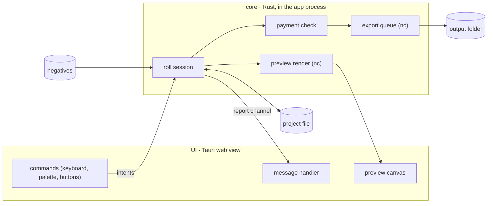

# Hanten desktop app

**Status:** agreed 2026-10-15; open questions in §5. Requirements come from the GUI
brainstorm (2026-10-14/15); the data flow builds on the closed prototype spike,
`docs/spike/native-app-prototype.md` ("spike unknown N" below refers to its list).

## 1. What the app is

A desktop app that turns a roll of film negative scans into finished positives, for film
shooters. It is for two groups:

- people the existing tools fail: Negative Lab Pro is a Lightroom plugin with colour casts
  and weak exposure and contrast; SilverFast is a scanner tool with no use for camera
  scanning and no roll-level adjustment;
- people who want "good enough, fast". Today's default render already beats most existing
  apps.

The app **replaces the CLI** for most users: every step a typical roll needs, measuring
included, works without a terminal. The CLI stays internal and is not published (its source is, §5); any future
public CLI or MCP tool carries the same payment (§2.11).

It is **not** a photo library and **not** a general editor. Editing stays within Hanten's
own functions: its conversion knobs and its frame operations (crop, rotate, split), which
are Hanten features not yet implemented in the CLI (§4).

## 2. Requirements

### 2.1 The roll is the project

- A roll is one project file. Converting a single frame is not a goal.
- Flow: create or open a project → add the roll's files and measure → preview → change
  config (loop) → export to a folder. Reopening the project resumes the work.
- Base and leader frames are detected automatically or pointed out by the user. Both are
  optional, but the app pushes for a base, since it makes the conversion more accurate.
  Without a base frame, the base is estimated automatically from the roll's pictures (the
  content base); the user marks nothing. A rebate area the user marks is a possible later
  upgrade, only if camera scans show the content base is not good enough.

### 2.2 Config tiers

| Tier | Controls | CLI knobs | Visibility | Form |
|---|---|---|---|---|
| 0. Auto | the roll's measurements | `--roll-*` | Convert is enabled once the roll is measured | none; re-measure, never hand-edit |
| 1. Placement | placement | `--placement` | always visible | three named choices |
| 2. Taste | exposure, contrast, saturation, overall cast, tone cast | `--exposure`, `--contrast`, `--saturation`, `--white-balance`, `--channel-grade` | collapsed, easy to find | sliders and a colour control |
| 3. Behaviour switches | highlight desaturation, lifts, midtone neutral, roll colour correction, dark end, … | `--highlight-desaturation`, `--small-lift`, `--thin-lift`, `--midtone-neutral`, `--colour-correction`, `--dark-target`, … | hidden deeper; meaning may change | on/off or a few named steps |
| Not in the app | debug rendering, decode and calibration, film master | `--rendering` (always `default`), `--density-*`, `--linearization`, `--anchor-mid-offset`, `--input-*` (as controls; the core may set them per camera file, `io/camera-scan-input`), `--film-master` (leaning) | — | — |

- Every app control maps to a flag and recipe key; not every flag gets a control. Output
  axes belong to the export dialog; operational flags (`--report`, `--telemetry`,
  `--max-memory`, `--strict`) are app settings or nothing.
- Taste-tier features may be cut later.
- Not in the first build: looks (named or saved), a white-balance picker (dropped),
  nudges toward taste controls (later, suggest-only).

### 2.3 Roll and frame

- **Placement** is per roll, never per frame. The last choice is the default for new rolls.
- **Tiers 2 and 3** work at both levels: with no frame selected a change applies to the
  roll; with frames selected it overrides those frames.
- **A frame override is an offset on the roll**: a frame at +0.3 follows to +0.8 when the
  roll is raised by 0.5. Per kind of knob (`docs/spike/frame-offset.md`):
  - exposure: a step in EV;
  - contrast and saturation: a ratio on the roll's multiplier, so a frame at × 0.7 stays
    30 % flatter wherever the roll moves (contrast by review, saturation by the algebra);
  - overall and tone cast: a ratio per channel;
  - tier-3 switches and named steps: a plain override, which does not follow the roll.
  A roll change that would push a frame's grade out of range is refused, naming the frame.
- **Copy config** applies a frame's override to other selected frames; **reset** clears it.
  **Lift config** promotes one frame's value to the roll and clears that frame's override.
  Other frames that override that knob keep their picture: their offsets are restated
  against the new roll value. Frames with no override follow it. Lift needs one source
  value, so it is unavailable over frames with different values. No "sync settings" and
  no Lightroom-style copy/paste.
- A frame's control shows its value, the roll's beside it, and the offset in the knob's
  unit (`+0.3 EV`, `× 0.7`); ratio knobs use log-scale sliders.

### 2.4 Frame operations

- First release: **crop, rotate, split** (one file holding two half-frames → two pictures;
  a half-frame roll may show up to 80).
- Each lands as a CLI flag and recipe key before the app uses it.
- A crop also narrows the measurement region, so it re-measures that frame and can shift the
  roll's measurements; the UI says so or batches re-measuring until cropping is done.
- Not discussed yet: straighten, the holder outline, dust removal.

### 2.5 Viewing

- No 1:1 zoom in the first build.
- Before/after is nice to have: at roll level "before" is the default config with the
  selected placement; at frame level it is the roll config.
- Overlays, histograms, diagnostics: low priority.

### 2.6 Export

- A background queue; files are named automatically; a re-export adds a suffix rather than
  overwriting.
- The export dialog offers the destination axes in words users know (lossless, HDR, …).

### 2.7 Messages

- Every core run, previews included, reports its warnings, errors and progress to the UI
  through one channel.
- One handler in the UI decides per message: retry or update silently, prompt the user to
  change config, or show an error. Silent retry only for transient faults, never for one
  that changes the image.
- A colour-management (lcms2) fault is an error, not a quietly wrong preview (spike
  unknown 5), scoped to the render that raised it and sent to the report channel. Today's
  handler is one process-global flag that writes to stderr, and a preview and an export
  racing on it take or lose each other's faults. One lcms2 context per render job, with
  its own handler, keeps each fault with its render; a context without a handler drops
  its faults (`docs/spike/export-beside-preview.md`, Q4).

### 2.8 Files and persistence

- The project file sits with the negatives, not in an app database: users move scan
  folders, and most delete the negatives after converting.
- The file is app-owned; hand edits are not supported. It stores every resolved value, so
  an open roll keeps its old defaults after an update.
- Non-destructive by construction: output is always re-rendered from negatives + config.
- An unwritable folder is a write error; the app asks for another folder.
- A cloud file not fully downloaded (spike unknown 11) is a named fault, which the handler
  can retry. In iCloud Drive the first read downloads the whole file (about 1.3 s per
  frame) and fails with `ETIMEDOUT` when offline (`docs/spike/file-access.md`).
  Treated as an edge case but tested; on a streamed folder it can hit most of a roll.

### 2.9 Versioning

- Backward compatibility is low priority. An old project is migrated on open; migration
  keeps settings, not pixels, so a re-render may differ (a known issue).
- Versions are reset before the first release, so migration matters only after it.

### 2.10 Platform and interaction

- **macOS only** may be enough for the first release; Windows, then Linux, are low
  priority; mobile is out of scope.
- **Keyboard-first** is a goal (not the top priority): every action is a named command
  from the start, reachable by shortcut and a command palette.
- **Placement tutorial** on first run: the user's own roll under each placement side by
  side, and an animation of how frames' scene spans land on the image range under each
  placement (a separate task).

### 2.11 Pricing

- Paid per roll: one base, one leader, at most 40 scan files. The cap counts files, not
  pictures, so a split half-frame file counts once.
- At the first export each exported file's **content** hash is recorded (never file
  names). Adding frames up to the cap is free; replacing exported frames with different
  content is refused (that is a new roll), except a limited number of replacements, e.g. a
  rescan for dust or focus.
- Changing config and re-exporting are free.
- Tokens are bought online and spent offline. Light protection is enough, using the
  system's protection where possible. The paid record lives in the project file; losing
  the file means paying again, as a rescan does.
- **The payment check lives in the core**, not only in the UI.

### 2.12 Release gates

- **Camera-scan input.** Hanten reads SilverFast HDR/HDRi; any other 16-bit RGB TIFF
  converts only when the user asserts it is a linear raw scan, and RAW/DNG is not read.
- **A website selling tokens** (outside this repository): a payment provider that handles
  sales tax, accounts, a server that signs tokens bound to a device key (the signing key
  never ships), getting tokens into the app, and moving them to a new Mac
  (`docs/spike/offline-token.md`). The Mac App Store's in-app purchase is a
  lower-priority alternative.
- **The WebKit checks** (§3.1): passed on macOS (`docs/spike/webkit-display.md`).
- **Apple Developer Program enrollment**, for the Developer ID certificate, notarization
  and the provisioning profile that the device key's keychain needs (§3.8,
  `app/signed-build-spike`).

## 3. High-level design

### 3.1 Shell

- **Tauri first**; if WebKit blocks, Electron, then Dioxus or GPUI. The core is UI-agnostic
  so a fallback replaces only the shell.
- **WebKit checked on macOS** (`docs/spike/webkit-display.md`): a Display P3 2D canvas
  shows P3 unclipped and matches the export; the HDR preview is a WebGPU canvas with
  `toneMapping: extended` (tested on the built-in XDR only). Each later platform repeats
  the check, since Tauri's web view differs per platform.

### 3.2 Core and the `nc` library

- `nc` gains a library target. The preview lives **inside** `nc`, with the app as a thin
  caller, because the stage boundary types are crate-private (spike unknown 1).
- The doc gate needs `--document-private-items` or allowing private intra-doc links
  (spike unknown 2).
- The core stamps `recipe_version` on every layer it builds; the UI never sees recipes
  (spike unknown 3).
- The **roll session** owns the project: the roll's measurements, roll config, per-frame
  overrides and frame operations, and resolves each frame's recipe from them. The UI sends
  intents (set a knob on a selection, lift, reset, crop …) and receives state and
  messages.
- The roll session is an orchestrator beside the CLI; stages stay pure and never touch
  files (design-spec §3, principle 6).
- The app installs `nc`'s global allocator, as the CLI's `main.rs` does; the library
  leaves the choice to its host binary.
- The app binary is the only executable. Anything in the core that re-launches
  `current_exe()` re-launches the app: today that is the telemetry upload helper
  (`telemetry upload-once`). The app catches it in `main` before the UI starts, or moves
  the upload onto a thread (`docs/spike/packaging.md`).

### 3.3 Report channel (proposal)

- Each message carries a **stable code**, a severity, the frame it concerns and its facts
  (numbers, paths). The UI's wording is the UI's; the CLI keeps its prose by formatting the
  same codes, so the two never drift.
- Warnings written for the command line (spike unknown 4: "drop it" on every exposure
  tweak, the unused IR plane on every HDRi export) become codes the app may ignore.
- Preview runs produce a report too, so a warning that changes the image being judged
  reaches the UI.

### 3.4 Project file

- JSON with its own schema version, migrated on open.
- Frames keyed by path relative to the project file (absolute when it can't be), as
  `roll.frames` is keyed relative to its recipe (`core/frame-keys-by-path`; spike unknown 9). A missing file
  prompts the user to locate it.
- Holds the measurements, every resolved value, frame overrides (offsets, or plain values
  for tier 3; §2.3), frame operations, and the paid record (the token, per-frame content
  hashes, replacements and the device's seal; `docs/spike/offline-token.md`).

### 3.5 Preview and cache

- The cache point is the downsampled scan: decoded transmission before the film base,
  box-averaged to a 2048 edge, stored as f16 (11 MB a frame, 0.4 GB for 36). A knob
  change then renders in 37–54 ms once the display curve skips lcms2, ~73 ms through it
  (`docs/spike/webkit-display.md`); widening f16 adds ~2 ms.
- Newest request wins during a slider drag.
- Opening a roll (`docs/spike/preview-cache.md`):
  - The current frame alone, then two prepare workers outward: the first preview in
    0.15–0.4 s and 34 frames in 2.3–3.2 s from a fast SSD (inferred from 1- and
    2-worker runs).
  - An unmeasured roll decodes each frame once, for its downsample and its measurement,
    on the same workers. The measurements pool in input order, so the result equals
    `measure-roll`'s. The base comes first, since the chain needs it to render. An
    `auto` base or leader, or a content base, reads the frames in a first pass, which
    can fill the cache; the first preview then waits for that pass.
- Memory: the cache plus up to ~265 MB per frame decoding and ~300 MB for an export.
  Over budget, the frame furthest from the current one goes first. `pipeline/memory.rs`
  needs a session model of that sum.
- A disk cache of the f16 scans in `~/Library/Caches` reopens a roll in ~0.1 s and
  makes eviction from memory cheap. An entry is keyed by the file's identity, the crop,
  and a version of the decode, the downsample and the entry format; never by the base
  or a rendering knob.

### 3.6 Export (in-process)

- Export runs **in the core process** as a queue, not by spawning a bundled `hanten`
  binary. A shipped binary would be an unpaid public CLI (though not the only free route,
  §5), and a second process would need its own route for messages.
- Preview takes priority over the queue for CPU and memory
  (`docs/spike/export-beside-preview.md`):
  - **Two thread pools.** The preview and the export each run in their own rayon pool,
    never the shared global one.
  - **A cooperative pause.** Export threads pause between stages and between pixel
    bands while the preview is active, so a drag stays near its idle latency (p99 42
    against 40 ms, worse under heavy machine load) and the export runs at full speed in
    the rests.
  - **No lowered QoS.** On Apple silicon it slowed the export 7× or more with no preview
    running.
- **One export at a time** (~300 MB each; a second adds 16% throughput). Export decodes
  its frame again rather than keeping the preview's full decode.
- An in-process export in a packaged app, under the hardened runtime, wrote a file
  byte-identical to `hanten convert` with the same recipe (`docs/spike/packaging.md`).

### 3.7 Payment

- The core checks a roll's paid record before each export and records content hashes at
  the first export. Tokens are verified with a public key built into the core.
- The token is signed before the roll exists, so its signature cannot cover the hashes.
  The binding is open (§5). A spike proposes one, not final: the server binds the token
  to the device's public key at download, that device seals the record, and a
  spent-token list in the Keychain caps what each token pays for
  (`docs/spike/offline-token.md`).

### 3.8 Packaging and updates

From `docs/spike/packaging.md`. It ran ad-hoc signed; the signed parts are
`app/signed-build-spike`.

- **Outside the Mac App Store**, with no sandbox: Developer ID signed, hardened runtime,
  notarized. The core and lcms2 need no entitlements. lcms2 must be linked statically
  (`LCMS2_STATIC=1`): library validation refuses a Homebrew copy found by pkg-config.
- **Updates** use Tauri's updater, which has its own signing key, separate from Apple's.
  - The endpoint is https.
  - `requireSignedVersion` is on, so an unsigned manifest can't pair a newer version
    number with an older archive.
  - The update swaps the bundle in place.
- **The bundle id is permanent.** With the team id, it names the device key's keychain
  access group, so changing it orphans every user's key.
- **Signatures:** the core asks `SecKey` for X9.62 DER and converts it to `r‖s`. On
  macOS 26, `SecKey`'s RFC 4754 output pads each half to 72 bytes.
- **Development builds** can't reach the data protection keychain, because they're
  unsigned. They keep the device key in a file, behind a Cargo feature that release
  builds never enable. The file-based keychain would prompt after every rebuild.
- **Telemetry consent** is the app's own: a record in its Application Support folder,
  asked for in the UI. Today's record is the CLI's (`~/.config/nc`).
- **File access** goes through the open panel (`docs/spike/file-access.md`). A picked
  folder, protected or not, opens with no prompt and stays open across relaunches and
  ad-hoc updates. Opening a protected folder the user did not pick prompts, and an ad-hoc update
  loses that grant, so the app opens only folders the user picked. A privacy refusal is
  `EPERM` and an unwritable folder `EACCES`; both are `PermissionDenied` in Rust, so the
  app branches on the errno.

## 4. New work the app needs first

Each lands in the CLI and recipe before the app uses it (the project's knob rule):

- Crop, rotate and split as flags and recipe keys; crop narrows the measurement region
  (`core/crop-rotate`, `core/half-frame-split`).
- Checking the content base on camera scans (a rebate area the user marks only if it
  falls short), with the spike below.
- Spike: can the content base use the rebate? Answered on the scanner archive: barely.
  `--measure-inset 0` moves one roll of 13, and adding a rebate search isn't worth it
  ([spike](../spike/content-base-rebate.md), `film-base/content-base-rebate`). Camera
  scans are still open, and there the sprocket holes are the likely risk.
- Message codes behind every warning and error (§3.3, `core/message-codes`).
- Naming a truncated file as its own fault (spike unknown 11, `io/truncated-file-fault`).
- Frame keys by relative path in the recipe (§3.4, `core/frame-keys-by-path`).
- Camera-scan input (a release gate, `io/camera-scan-input`).

## 5. Open questions

- The exact tier-3 list and the named steps for each number knob.
- Dragging a control with several frames of different values selected: one ratio or step
  for each, or one value for all (`docs/spike/frame-offset.md`).
- The replacement limit per roll (§2.11).
- How a token is bound to its roll so a paid record cannot be copied or edited (§3.7).
  The spike (`docs/spike/offline-token.md`) found that binding to a device strands a
  user's tokens on one Mac; likely spend online, or download one token just before
  spending it.
- The repository is public, so the CLI and the core can be built from source and the
  payment check removed: whether the core goes private before release, or light
  protection accepts this.
- The preview cache's open questions (`docs/spike/preview-cache.md`):
  - the priority of frame prepares beside an export;
  - whether the current frame can come before the leader;
  - the session memory model;
  - the disk cache's size cap and eviction order;
  - whether f16 holds for the HDR preview and knobs at their extremes (checked on SDR
    at the roll's settings only).
- Preview faithfulness: the downsample factor, and the HDR preview on an external HDR
  display (settled on the built-in XDR only).
- How the export dialog presents the four destination axes.
- Roll setup details (detecting base and leader, adding files).
- GUI ↔ CLI ↔ agents (copy a frame as a command, MCP): not designed yet.
- File access (§3.8): removable media, network volumes, Google Drive's streamed
  folders, a dropped folder, and how long a pick lasts (across a reboot or a moved
  folder) were not tested.
- The signed build (§3.8): notarization, whether the P-256 key syncs to a second Mac,
  and whether a Developer ID update keeps keychain access and a prompt-based folder
  grant without asking
  (`app/signed-build-spike`).
- Telemetry in the app: what the consent screen shows, and whether uploads use a helper
  process or a thread.
- The distribution format (dmg or zip) and where updates are hosted.
